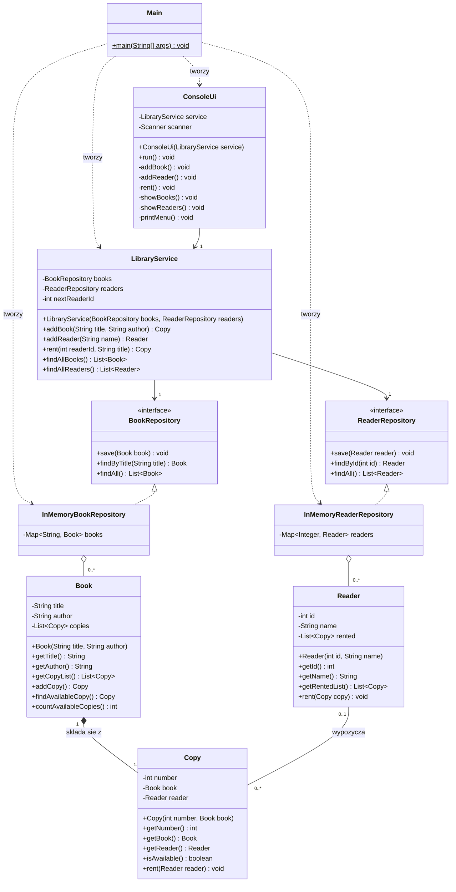
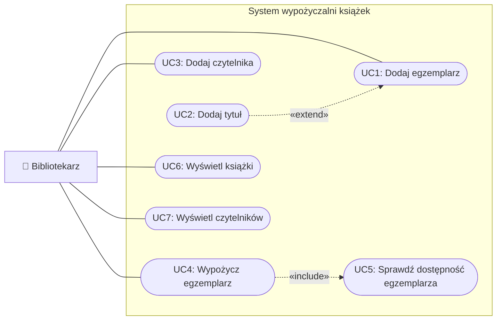

# Lista 2 – Wypożyczalnia książek

Konsolowa aplikacja do wprowadzania książek, egzemplarzy i czytelników oraz wypożyczania egzemplarzy.

## Uruchomienie

```bash
mvn compile
java -cp target/classes pl.pwr.tp.lista2.Main
```

Testy, Checkstyle i PMD:

```bash
mvn test
mvn checkstyle:check
mvn compile pmd:check
```

## Diagram klas



## Diagram przypadków użycia



## Scenariusze przypadków użycia

### UC1: Dodaj egzemplarz

| | |
|---|---|
| **Aktor** | Bibliotekarz |
| **Cel** | Wprowadzenie nowego egzemplarza książki do systemu. |
| **Warunki wstępne** | Program jest uruchomiony i wyświetla menu. |
| **Przepływ główny** | 1. Bibliotekarz wybiera opcję 1.<br>2. System prosi o tytuł.<br>3. Bibliotekarz podaje tytuł.<br>4. System prosi o autora.<br>5. Bibliotekarz podaje autora.<br>6. System wyszukuje tytuł w katalogu.<br>7. System tworzy egzemplarz z kolejnym numerem i dodaje go do książki.<br>8. System wyświetla numer dodanego egzemplarza. |
| **Rozszerzenie** | 6a. Tytułu nie ma w katalogu: wykonywany jest UC2, potem powrót do kroku 7. |
| **Warunki końcowe** | Książka ma o jeden egzemplarz więcej. |

### UC2: Dodaj tytuł (rozszerza UC1)

| | |
|---|---|
| **Aktor** | Bibliotekarz (w ramach UC1) |
| **Cel** | Wprowadzenie tytułu, którego nie ma jeszcze w katalogu. |
| **Warunki wstępne** | W UC1 podano tytuł, którego nie ma w katalogu. |
| **Przepływ główny** | 1. System tworzy książkę z podanym tytułem i autorem.<br>2. System zapisuje książkę w katalogu.<br>3. Powrót do UC1, krok 7. |
| **Warunki końcowe** | Tytuł istnieje w katalogu. |

### UC3: Dodaj czytelnika

| | |
|---|---|
| **Aktor** | Bibliotekarz |
| **Cel** | Wprowadzenie nowego czytelnika. |
| **Warunki wstępne** | Program jest uruchomiony i wyświetla menu. |
| **Przepływ główny** | 1. Bibliotekarz wybiera opcję 2.<br>2. System prosi o imię.<br>3. Bibliotekarz podaje imię.<br>4. System nadaje czytelnikowi kolejny numer id i zapisuje go.<br>5. System wyświetla numer id czytelnika. |
| **Warunki końcowe** | Czytelnik jest w systemie i ma unikalny numer id. |

### UC4: Wypożycz egzemplarz

| | |
|---|---|
| **Aktor** | Bibliotekarz |
| **Cel** | Wypożyczenie egzemplarza książki czytelnikowi. |
| **Warunki wstępne** | Program jest uruchomiony i wyświetla menu. |
| **Przepływ główny** | 1. Bibliotekarz wybiera opcję 3.<br>2. System prosi o id czytelnika.<br>3. Bibliotekarz podaje id.<br>4. System prosi o tytuł.<br>5. Bibliotekarz podaje tytuł.<br>6. System wyszukuje czytelnika i książkę.<br>7. System szuka wolnego egzemplarza (UC5).<br>8. System oznacza egzemplarz jako wypożyczony i dopisuje go do listy czytelnika.<br>9. System wyświetla numer wypożyczonego egzemplarza. |
| **Wyjątki** | 3a. Id nie jest liczbą: komunikat „Id musi byc liczba”, powrót do menu.<br>6a. Nie ma czytelnika o podanym id: komunikat, powrót do menu.<br>6b. Nie ma książki o podanym tytule: komunikat, powrót do menu.<br>7a. Brak wolnych egzemplarzy: komunikat „Brak wolnych egzemplarzy”, powrót do menu. |
| **Warunki końcowe** | Egzemplarz jest wypożyczony i znajduje się na liście czytelnika. |

### UC5: Sprawdź dostępność egzemplarza (dołączany do UC4)

| | |
|---|---|
| **Aktor** | Bibliotekarz (w ramach UC4) |
| **Cel** | Znalezienie wolnego egzemplarza wybranej książki. |
| **Warunki wstępne** | W UC4 znaleziono czytelnika i książkę. |
| **Przepływ główny** | 1. System przegląda egzemplarze książki.<br>2. System zwraca pierwszy egzemplarz, który nie jest wypożyczony. |
| **Wyjątki** | 2a. Wszystkie egzemplarze są wypożyczone: UC4 kończy się komunikatem (krok 7a). |
| **Warunki końcowe** | Znaleziono wolny egzemplarz albo zgłoszono jego brak. |

### UC6: Wyświetl książki

| | |
|---|---|
| **Aktor** | Bibliotekarz |
| **Cel** | Przegląd książek i liczby ich egzemplarzy. |
| **Warunki wstępne** | Program jest uruchomiony i wyświetla menu. |
| **Przepływ główny** | 1. Bibliotekarz wybiera opcję 4.<br>2. System wyświetla dla każdej książki tytuł, autora, liczbę wszystkich egzemplarzy i liczbę wolnych egzemplarzy. |
| **Przepływ alternatywny** | 2a. W systemie nie ma książek: wyświetlany jest tylko nagłówek listy. |
| **Warunki końcowe** | Stan systemu się nie zmienia. |

### UC7: Wyświetl czytelników

| | |
|---|---|
| **Aktor** | Bibliotekarz |
| **Cel** | Przegląd czytelników i wypożyczonych przez nich egzemplarzy. |
| **Warunki wstępne** | Program jest uruchomiony i wyświetla menu. |
| **Przepływ główny** | 1. Bibliotekarz wybiera opcję 5.<br>2. System wyświetla id i imię każdego czytelnika oraz numery i tytuły wypożyczonych przez niego egzemplarzy. |
| **Przepływ alternatywny** | 2a. W systemie nie ma czytelników: wyświetlany jest tylko nagłówek listy. |
| **Warunki końcowe** | Stan systemu się nie zmienia. |